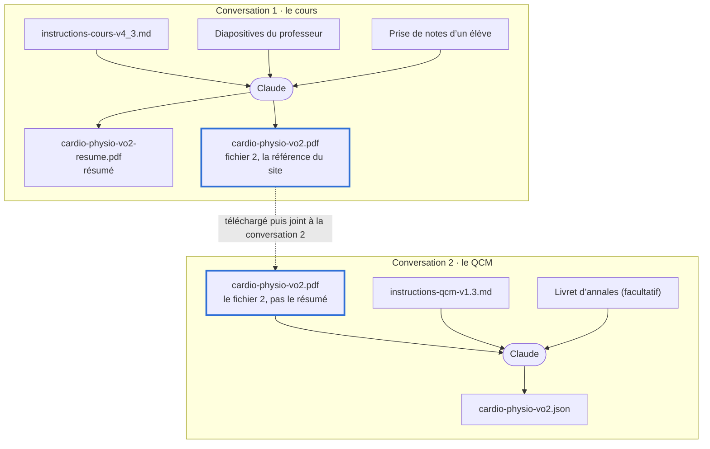
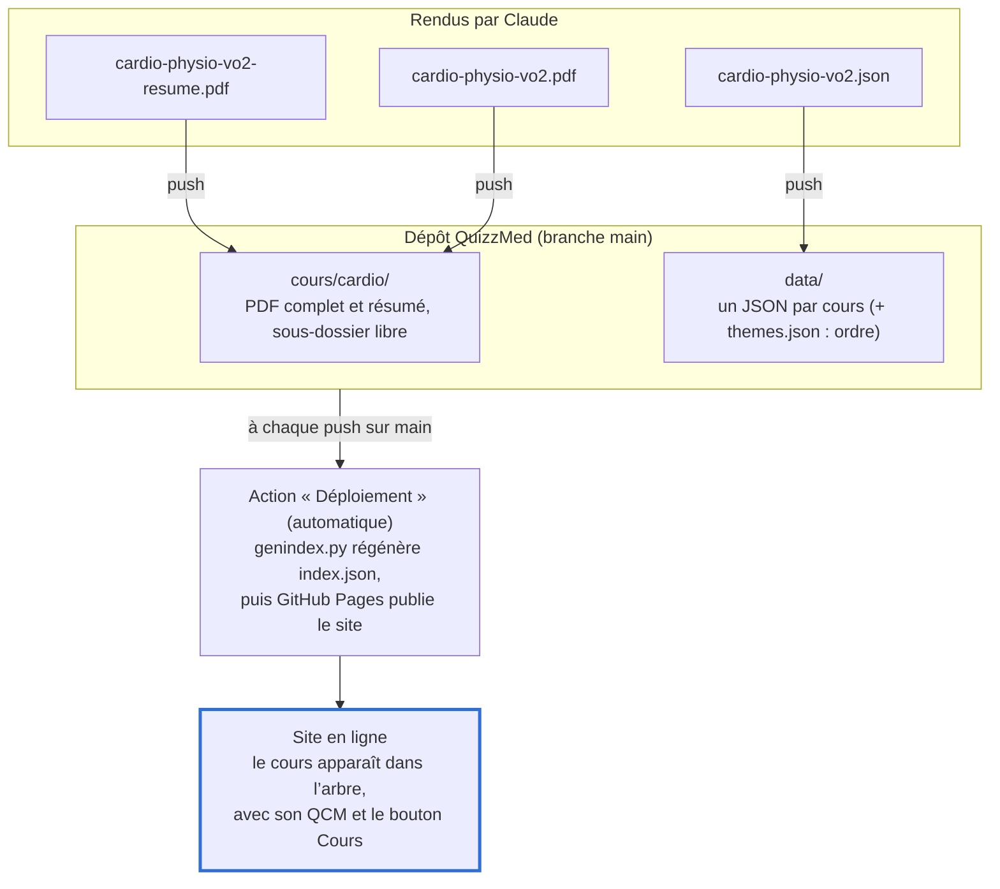

# QuizzMed : créer un cours et son QCM avec Claude

Nov 4, 2026 · @Valentin

## Vue d'ensemble

Un cours complet se fabrique en deux conversations séparées avec Claude, puis un dépôt de trois fichiers sur GitHub. L'exemple suivi tout du long est le cours de physiologie « VO2 ».



Le seul fichier qui passe d'une conversation à l'autre est la version complète du cours (le « fichier 2 ») : le QCM y renvoie par numéro de page et par passage surligné.

## Ce qu'il faut avant de commencer

Deux fichiers d'instructions se trouvent à la racine du [dépôt QuizzMed](https://github.com/ValentinStudMedRennes/QuizzMed) ; le reste, c'est vous qui l'apportez.

| Fichier | Où le trouver | Sert à |
| --- | --- | --- |
| `instructions-cours-v4_3.md` | Racine du dépôt | Consignes de la conversation 1 (fabriquer le cours) |
| `instructions-qcm-v1.3.md` | Racine du dépôt | Consignes de la conversation 2 (fabriquer le QCM) |
| Diapositives du professeur (PDF) | Chez vous | Source du cours |
| Prise de notes d'un élève (PDF) | Chez vous | Source du cours |
| Livret d'annales (PDF, facultatif) | Chez vous | Questions d'annales reprises dans le QCM |

Pour récupérer un fichier d'instructions : l'ouvrir sur GitHub, puis cliquer sur l'icône « Download raw file » en haut à droite du fichier. Prenez toujours la version actuelle du dépôt : son numéro (v4.3, v1.3) finit inscrit dans le cours et le QCM.

Côté Claude, l'option de création de fichiers doit être activée dans les paramètres : Claude doit rendre des PDF et un JSON téléchargeables.

## Étape 1 : la conversation « cours »

Cette conversation transforme les diapositives et les notes en deux PDF propres, dont un sert de référence au site.

1. Ouvrez une **nouvelle conversation** avec Claude, une par cours.
2. Joignez trois fichiers : `instructions-cours-v4_3.md`, les diapositives et la prise de notes.
3. Envoyez un message de ce type (la première ligne est importante, elle fixe le nom et le classement du cours) :

```
Thème : Appareil cardio-vasculaire — Section : Physiologie — Cours : VO2
Suis les instructions du fichier instructions-cours-v4_3.md avec les diapositives et la prise de notes jointes.
```

4. Claude rend deux PDF qui partagent le même nom de base :
   - `cardio-physio-vo2-resume.pdf` : le résumé, en A4 paysage sur 3 colonnes ;
   - `cardio-physio-vo2.pdf` : la version complète, dite « fichier 2 ». C'est elle que le site affiche et dont le QCM sera tiré.
5. Lisez le bilan de sa réponse : désaccords tranchés, points \[Incertain\], schémas illisibles. Demandez les corrections **dans cette même conversation**, avant de passer à l'étape 2.

Téléchargez les deux PDF : le fichier 2 est la seule chose à emporter dans la conversation suivante.

## Étape 2 : la conversation « QCM »

Cette conversation tire du fichier 2 un fichier JSON de questions, que le site sait lire.

1. Ouvrez une **autre nouvelle conversation** : ne continuez pas celle du cours.
2. Joignez `instructions-qcm-v1.3.md`, le **fichier 2** (`cardio-physio-vo2.pdf`, jamais le résumé) et, si vous l'avez, le livret d'annales.
3. Envoyez un message de ce type, avec **exactement** la même ligne Thème qu'à l'étape 1 :

```
Thème : Appareil cardio-vasculaire — Section : Physiologie — Cours : VO2
Suis les instructions du fichier instructions-qcm-v1.3.md avec le cours retravaillé joint (et le livret d'annales).
Dans meta.cours.fichier, mets seulement le nom du PDF, sans dossier.
```

4. Claude rend `cardio-physio-vo2.json` et un bilan : nombre de questions par chapitre, annales intégrées, items « à vérifier », annales non reprises.
5. Notez les annales non reprises : elles appartiennent à un autre cours et serviront dans sa propre conversation QCM.

La dernière ligne du message corrige un point dépassé des instructions, qui montrent encore un chemin `cours/…`. Ignorez aussi le rappel final de lancer `generer_themes.py` : le déploiement s'en charge désormais (étape 3).

## Étape 3 : déposer les fichiers sur le dépôt

Trois fichiers à déposer, puis tout se fait seul : le site est à jour quelques minutes après l'envoi.



Le dossier sous `cours/` est libre : le site retrouve le PDF par son seul nom.

1. Les deux PDF dans un sous-dossier de `cours/` (ex. `cours/cardio/`).
2. Le JSON dans `data/`.
3. Facultatif : ajouter `"cardio-physio-vo2.json"` dans `data/themes.json` pour choisir l'ordre d'affichage. Sinon, le cours vient après les autres, par ordre alphabétique.
4. Envoyer sur la branche `main` : `git push`, ou sur GitHub « Add file › Upload files » dans le bon dossier.
5. Vérifier dans l'onglet Actions que « Déploiement » a réussi (coche verte).

Il faut les droits d'écriture sur le dépôt ; sinon, transmettez les trois fichiers à son propriétaire. Pour tester en local avant d'envoyer : `python3 genindex.py`, puis `python3 -m http.server`.

## Pièges à éviter

| Erreur | Ce qui se passe | À faire |
| --- | --- | --- |
| Ligne Thème différente entre les deux conversations | Le cours apparaît sous un thème à part sur le site | Copier-coller la même ligne |
| Régénérer le fichier 2 après avoir fait le QCM | Les renvois de page et les passages surlignés deviennent faux | Refaire aussi le QCM : joindre l'ancien JSON et demander une mise à jour |
| Donner le résumé à la conversation QCM | Les renvois pointent vers le mauvais PDF | Toujours joindre le fichier 2 |
| Deux PDF du même nom dans deux dossiers | Le site affiche une erreur et aucun lien vers le cours | Un nom de base unique par cours |
| Tout faire dans une seule conversation | Contexte trop long, consignes mélangées | Une conversation par étape et par cours |

Pour contrôler l'ensemble, `python3 diag.py` (en local, après `pip install pypdf`) liste chaque cours avec ses versions et signale QCM manquant, PDF en double ou versions qui ne concordent plus.
